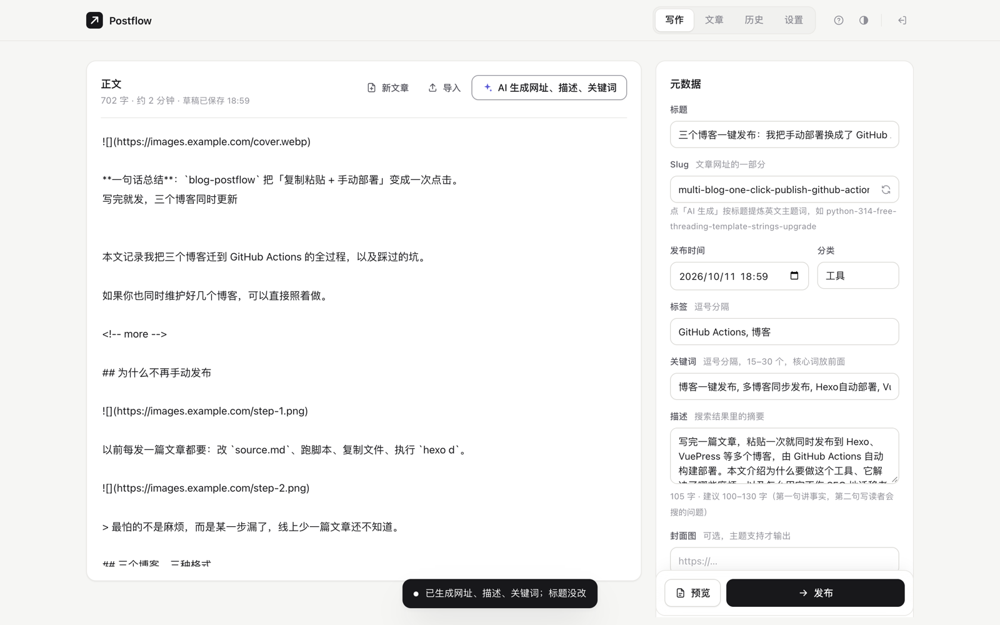
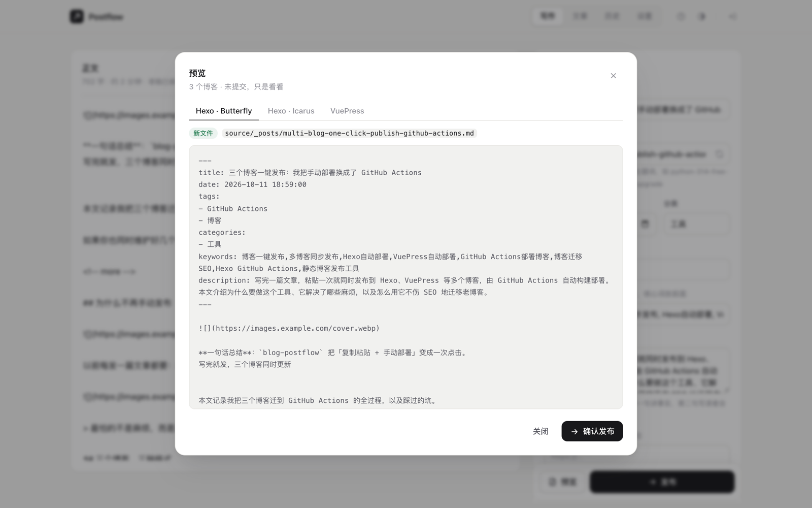
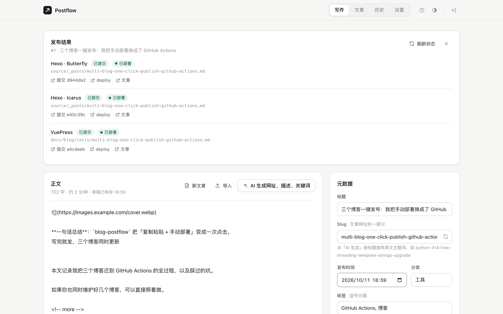
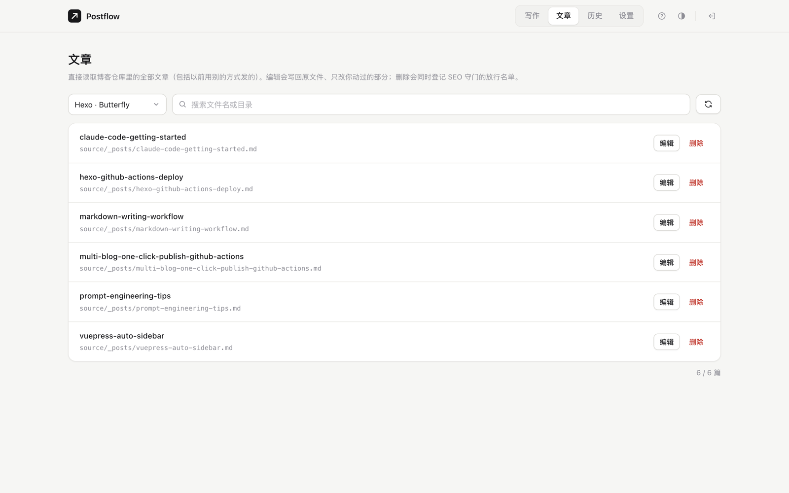
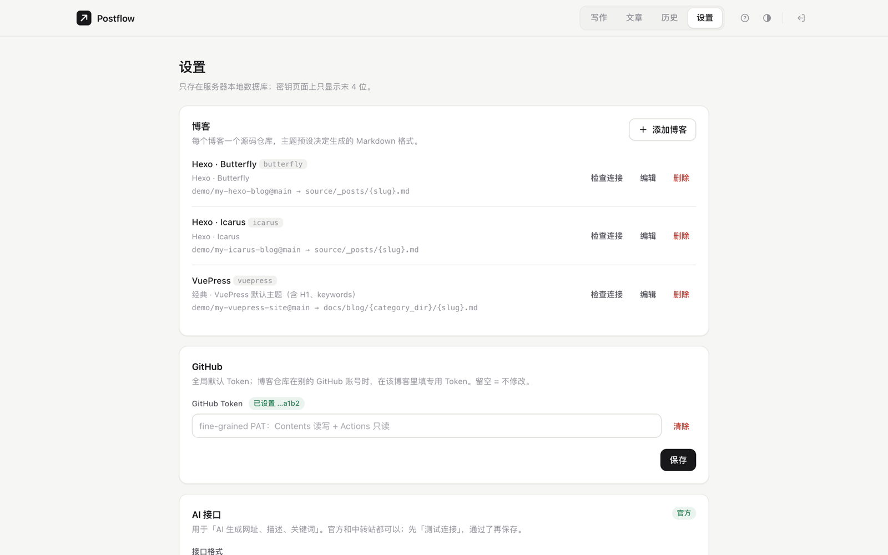
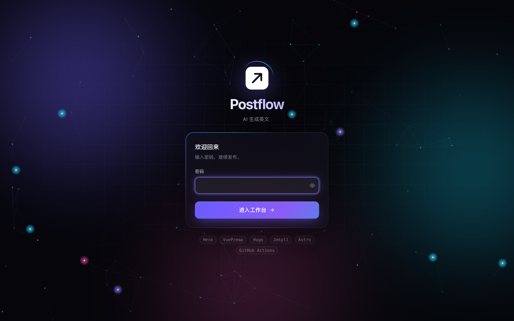
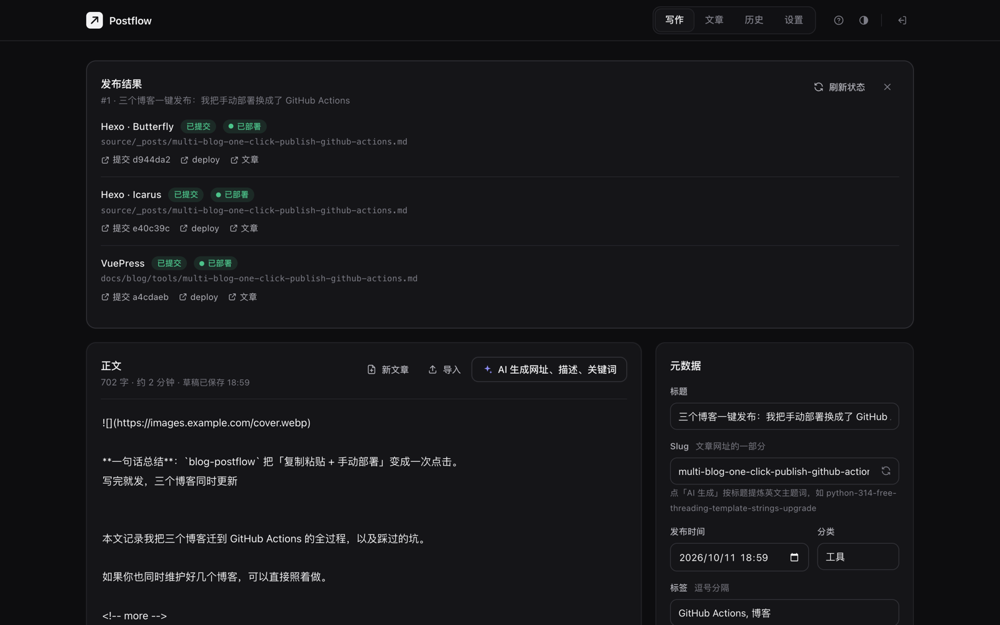

<div align="center">

<picture>
  <source media="(prefers-color-scheme: dark)" srcset="docs/images/logo-dark.svg">
  
</picture>

# Postflow

**Paste once, publish to all your static blogs.**

Postflow turns one article into the Markdown each of your blogs expects (Hexo / VuePress / Hugo / Jekyll / Astro …), commits it to each blog's source repo, and lets GitHub Actions build and deploy — with a page-by-page comparison against the live site before every deploy, so **old pages never silently lose their SEO**.

English | [简体中文](README_zh.md)




</div>

> The web UI is currently in Chinese. Detailed docs under `docs/` and `workflows/` are in Chinese as well; this README covers everything you need to get started.

## Why this project exists

I write articles for a WeChat Official Account first, then republish them on three independent blogs: two Hexo sites (different themes) and one VuePress site. Each blog wants different front matter and deploys differently. Publishing one article used to mean:

1. Opening the one Windows machine that had the blog sources;
2. Pasting the article into `source.md` and hand-editing title, date, tags, categories, description and keywords;
3. Running a Python script to generate three differently formatted Markdown files;
4. Copying each file into the right blog folder;
5. Running `hexo clean && hexo d -g` / `deploy.sh` three times — one of them asked for a server password every time.

15–20 minutes per article, tied to a single computer, and if one step was skipped a blog would silently miss a post.

Moving all this to CI raised a bigger worry: these blogs have been online for years and live on search traffic. **Change the build environment (Windows → Linux) and file ordering, filename case, modification times, time zone and line endings can all change.** Old pages' URLs, body HTML, `<title>` and sitemap entries drift without any error, and rankings drop.

So Postflow does two things:

- **Publish**: paste once in the browser → AI fills in SEO metadata → Markdown is generated per blog theme → committed to each source repo through the GitHub API → each repo's Actions build and deploy. Works from a phone too.
- **Guard**: before every deploy, the new build is compared page by page with the live site. Missing pages, changed article bodies or URLs dropped from the sitemap **block the deploy**. New setups start in *shadow mode* (build + compare only) and are switched on only after a zero-diff report.

The author's own three blogs (two Hexo, one VuePress) have been migrated with it and publish through it: page-by-page comparison before and after the switch showed zero changes to old article bodies and no URLs lost from sitemaps.

## Screenshots

| Preview: one Markdown file per blog | Result: commits + Actions status |
|---|---|
|  |  |
| **Articles: manage existing posts in each repo** | **Settings: blogs, tokens, AI provider** |
|  |  |
| **Login** | **Dark mode** |
|  |  |

## Features

**Writing and publishing**
- Paste rich text and get Markdown: Feishu/Lark docs, the WeChat editor, web pages, Word / Google Docs (headings, bold, lists, code blocks, tables, links, images). `⌘Z` undoes the conversion, `⌘⇧V` pastes plain text. Images that need a login or are hotlink-protected are flagged.
- AI generates an English slug, a 100–130 character description and keywords — **your title is never rewritten**. Without AI, a pinyin slug is generated from the title.
- Preview the exact file each blog will receive; existing files are detected and only overwritten when you tick the box.
- Publish to several blogs at once; **one blog failing never affects the others**. Retry or publish to newly added blogs from the history page.
- Polls GitHub Actions after publishing and links to the commit, the run and the article.
- H1 headings inside a new article's body are demoted so each page has a single H1.
- Draft autosave, import / drag-and-drop `.md`, reading time, shortcuts (`⌘↵` preview, `⌘⇧↵` publish, `?` help), light / dark theme.

**Many blogs, many themes**
- 14 theme presets: Hexo (generic / Butterfly / NexT / Fluid / Icarus), VuePress theme-hope, VitePress, Hugo, Jekyll, Astro, Docusaurus, plus 3 "classic" formats.
- Per-blog YAML overrides in the settings page: `fields`, `date_format`, `<!-- more -->` placement, H1 handling, and more.
- Filename / URL templates with `{slug}` `{year}` `{month}` `{day}` `{category_dir}`; category-to-subfolder mapping for sites that build their sidebar from folders.
- Blogs can live under different GitHub accounts: each blog can have its own token, falling back to a global one.

**Managing existing posts**
- The Articles page lists every post in a repo (including ones published before Postflow). Editing rewrites **only the fields you changed**; everything else stays byte-for-byte identical.
- Deleting a post or changing its body registers the page in the SEO guard's allow-list, in the same commit.

**SEO guard (runs in GitHub Actions)**
- Shadow mode: build and compare only; the report goes to the Actions run summary. Set one repo variable to actually deploy.
- Blocks: missing pages or files, URLs dropped from the sitemap, changed `CNAME` / `robots.txt` / `ads.txt`, changed bodies of existing pages.
- Warns: changes to title, description, keywords, canonical, og:*, JSON-LD, h1.
- See [workflows/README.md](workflows/README.md).

**Security**
- Single user: scrypt password hashing, login rate limiting, CSRF tokens, CSP and other security headers. First-time setup requires a one-time code printed to the server log.
- Secrets are stored only in the server's local SQLite file and shown as the last 4 characters.
- AI endpoints pointing at private / loopback addresses are rejected by default (prevents probing the server's internal network via "Test connection"); an environment variable can allow them.

## How it works

```
Browser ──login──▶ Postflow (FastAPI + SQLite, build-free single-page UI)
                    · AI: slug / description / keywords (Anthropic or OpenAI-compatible APIs)
                    · Adapters render Markdown per theme preset
                    · Commits via the GitHub API (Contents / Git Data API)
                    ▼
        Blog source repos ×N ──push──▶ GitHub Actions
                                         · build (hexo / vuepress / …)
                                         · compare_site.py vs. the live site (SEO guard)
                                         · deploy only if nothing is blocked (GitHub Pages / your own server)
```

Postflow only generates Markdown and commits it. Building and deploying happen in each blog's own Actions workflow, so Postflow never needs your server password or a Node toolchain.

## Quick start (local)

```sh
git clone https://github.com/ZekerTop/blog-postflow.git
cd blog-postflow
python3 -m venv .venv && .venv/bin/pip install -r requirements.txt
POSTFLOW_COOKIE_SECURE=false .venv/bin/uvicorn --factory app.main:app_from_env --port 8000
```

1. Open http://localhost:8000 and set a login password using the **setup code** from the startup log (also written to `data/setup-code.txt`).
2. Settings → GitHub: add a [fine-grained PAT](https://github.com/settings/personal-access-tokens) scoped to your blog source repos with **Contents: read & write** and **Actions: read**.
3. Settings → AI (optional): Anthropic (official or a compatible proxy) or any OpenAI-compatible API (DeepSeek, Kimi, OpenRouter, …). Test the connection, then save.
4. Settings → Blogs → Add: pick a theme preset, enter the source repo and branch, click "Check connection".
5. Go back to the editor, paste an article, preview, publish.

> Local development runs over plain http, hence `POSTFLOW_COOKIE_SECURE=false`. Keep the default `true` behind HTTPS. All other environment variables are optional; see [.env.example](.env.example).

## Deploy with Docker

```sh
docker build -t postflow .
mkdir -p data && sudo chown 10001:10001 data
docker run -d --name postflow --restart unless-stopped \
  -p 127.0.0.1:8790:8000 -v "$PWD/data:/data" \
  --read-only --tmpfs /tmp --cap-drop ALL --security-opt no-new-privileges \
  postflow
docker logs postflow   # shows the setup code
```

Put nginx with HTTPS in front of it (example: [deploy/nginx.example.conf](deploy/nginx.example.conf)). Server setup, backups, upgrades and rollback are covered in [docs/DEPLOY.md](docs/DEPLOY.md).

## Adding a blog

1. Put the blog's **source** (not the built site) in a GitHub repo — private is recommended.
2. Copy the closest workflow from [`workflows/examples/`](workflows/examples) to `.github/workflows/deploy.yml` in that repo, put `compare_site.py` in `.github/scripts/`, and configure the secrets.
3. Push once. Actions will build and compare against the live site without deploying. When the summary shows **zero blocking issues**, add the repo variable `DEPLOY_ENABLED=true`.
4. Add the blog in Postflow's settings and check the generated format against one already published post (load it from the Articles page and preview).

Migrating from a local Windows build and need byte-identical output (file order, mtimes, line endings, locale …)? See [workflows/README.md](workflows/README.md).

## Theme presets

| Preset | Notes |
|---|---|
| `hexo` / `hexo-butterfly` / `hexo-next` / `hexo-fluid` / `hexo-icarus` | Hexo and popular themes |
| `vuepress-hope` / `vitepress` | VuePress theme-hope, VitePress |
| `hugo` / `jekyll` / `astro` / `docusaurus` | Other common static site generators |
| `classic-hexo` / `classic-hexo-abbrlink` / `classic-vuepress` | Classic formats (description + keywords + sidebarDepth), verified byte-for-byte against real published posts |

Apart from `classic-*`, presets follow each theme's documented front matter. **Check one published post before going live**; if something differs, override `fields` and friends in the settings page, or add a preset in [`app/adapters/presets.py`](app/adapters/presets.py) (PRs welcome).

## Development

```sh
.venv/bin/python -m pytest -q    # 114 tests; GitHub and AI calls are mocked, no network access
```

The code is layered `api → services → adapters / integrations / storage → domain / core`; dependencies only point downward, enforced by `tests/test_architecture.py`. Where to change what and how to troubleshoot: [docs/ARCHITECTURE.md](docs/ARCHITECTURE.md).

## Known limitations

- **Single-user** tool; no accounts or roles.
- **GitHub only** (source repos and Actions); no GitLab / Gitea yet.
- Images are not re-hosted: replace Feishu / WeChat image links with your own image host first.
- AI prompts are tuned for **Chinese content and Chinese search engines** (Baidu). For English blogs, adjust the prompt in `app/integrations/claude.py`.
- The UI is Chinese only for now.
- On narrow phone screens (~390px) the top navigation labels wrap; it works, but the layout needs polish.

## License

[MIT](LICENSE)
